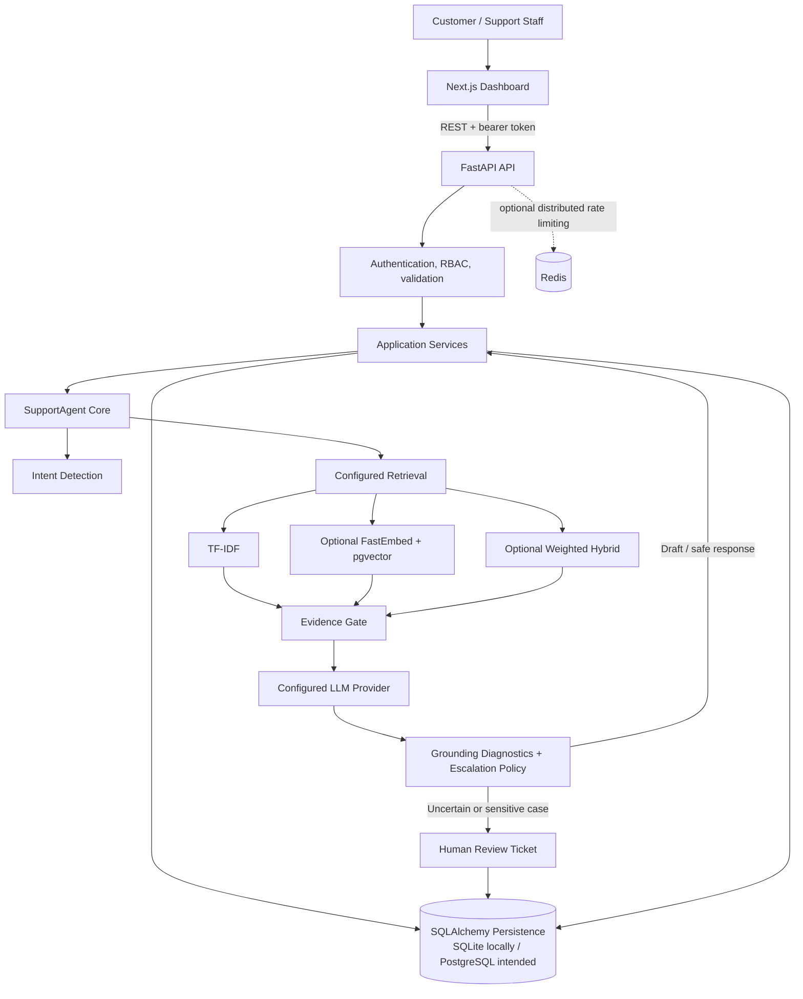
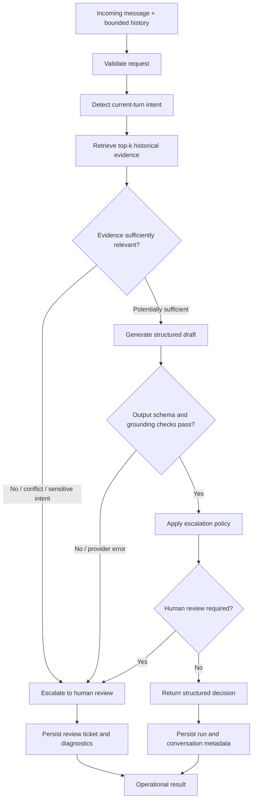

# Assistly — AI Customer Support Platform


**An AI-assisted customer-support system that retrieves historical resolutions, drafts evidence-aware replies, and escalates uncertain cases to a human support workflow.**

Assistly combines an independently testable Python agent core with a FastAPI service, a Next.js customer/staff dashboard, relational persistence, configurable retrieval backends, and reproducible evaluation tooling. It is a portfolio engineering project and a **production-oriented foundation—not a claim of production readiness**.

[Repository](https://github.com/amaan-mansoori/assistly-ai-support-agent) · [CI workflow](https://github.com/amaan-mansoori/assistly-ai-support-agent/actions/workflows/ci.yml) · [Evaluation reports](reports/evaluation/final_evaluation.md) · [Decision log](reports/decision_log.md)

---

## Contents

- [Highlights](#highlights)
- [System architecture](#system-architecture)
- [Agent request flow](#agent-request-flow)
- [Technology stack](#technology-stack)
- [Features](#features)
- [Evaluation: results and caveats](#evaluation-results-and-caveats)
- [Quick start](#quick-start)
- [API overview](#api-overview)
- [Testing and CI](#testing-and-ci)
- [Repository map](#repository-map)
- [Resume-ready project entry](#resume-ready-project-entry)
- [Known limitations](#known-limitations)
- [Project documentation](#project-documentation)

## Highlights

- **Evidence-aware agent orchestration:** deterministic intent detection, historical-response retrieval, structured reply generation, grounding diagnostics, and conservative escalation.
- **Retrieval choices:** TF-IDF lexical baseline, optional FastEmbed + PostgreSQL/pgvector semantic retrieval, and configurable weighted hybrid retrieval.
- **Human-in-the-loop workflow:** persistent conversations, support tickets, assignment/status transitions, and staff access controls.
- **Backend engineering:** FastAPI REST endpoints, SQLAlchemy models, Alembic migrations, idempotent message submission, configurable rate limiting, and health/readiness routes.
- **Full-stack dashboard:** Next.js/TypeScript UI for customer conversations, staff ticket handling, and admin analytics.
- **Evaluation-first development:** baselines, integrity-checked artifacts, regression gates, failure analysis, and an independent retrieval-relevance workflow whose metrics stay unmeasured until human judgments exist.
- **Automated checks:** GitHub Actions runs Python tests/lint/security checks and frontend audit/type-check/build.

## System architecture

This diagram describes the intended application composition. PostgreSQL/pgvector and the complete Compose stack are implemented in the repository, but their full runtime operation is not claimed as independently verified by the latest offline checks.



### Agent decision flow



**Important:** retrieval and grounding checks are heuristic safeguards, not proof that a reply is factually correct. User messages, history, and evidence are treated as untrusted inputs. Provider output must follow a constrained structured contract; uncertain, sensitive, unsupported, or failed requests route to review.

## Technology stack

| Layer | Technologies |
|---|---|
| Language and API | Python 3.14, FastAPI, Pydantic |
| Agent and ML | Intent taxonomy/rules, scikit-learn, TF-IDF, structured LLM-provider adapters |
| Retrieval | TF-IDF cosine similarity; optional FastEmbed CPU embeddings, PostgreSQL/pgvector, weighted hybrid fusion |
| Persistence | SQLAlchemy, Alembic, SQLite for local/testing, PostgreSQL for intended durable deployment |
| Platform | JWT bearer authentication, role-based access control, idempotency keys, rate limiting, health/readiness, process-local metrics |
| Frontend | Next.js 15, React 19, TypeScript, Tailwind CSS 4 |
| Infrastructure | Docker, Docker Compose, PostgreSQL/pgvector, optional Redis |
| Quality | pytest, Ruff, pip-audit, npm audit, TypeScript checks, Next.js build, GitHub Actions |

## Features

### AI support agent
- A reusable `SupportAgent.handle(...)` orchestration entry point.
- Bounded conversation-history handling and deterministic intent detection.
- Retrieval query construction with the current customer turn prioritized.
- TF-IDF by default; optional vector or hybrid retrieval for the FastAPI platform.
- Evidence sufficiency/conflict checks, structured reply contract validation, lexical grounding diagnostics, and conservative escalation.
- Configurable provider, model, timeout, retry count, retrieval thresholds, and escalation behavior.
- Sanitized operational logging with request IDs and stage timings; customer message content and credentials are not intentionally written to operational logs.

### Customer and staff platform
- Customer registration/login and role-aware authorization for customer, agent, and admin actions.
- Conversation and message persistence with idempotency keys.
- Human-review ticket lifecycle: list, assign, start, inspect, and resolve.
- Feedback collection and admin analytics.
- Readiness endpoint that checks the database; admin-only process-local metrics.
- Configurable rate limiting with Redis coordination when configured and a process-local fallback otherwise.
- Retention preview by age and explicitly opted-in deletion command.

### Retrieval and knowledge
- Historical AmazonHelp customer/resolution pairs are used to build the TF-IDF retrieval corpus after documented preparation.
- The retrieval path excludes frozen evaluation IDs and normalized exact-text duplicates.
- Optional knowledge ingestion and pgvector retrieval use a fixed 384-dimensional vector contract.
- Hybrid retrieval uses configurable lexical and semantic weights (default 0.5/0.5); these weights are engineering defaults, not weights optimized on independently judged relevance labels.

### Research and evaluation
- Majority-class and TF-IDF + Logistic Regression classification baselines.
- Historical retrieval diagnostics and privacy-minimized failure examples.
- Stored reply-quality analysis and a separate human reply-quality audit.
- Dataset/manifest hash checks and evaluation regression gates.
- Independent 50-query / 250-candidate retrieval relevance review workflow with two reviewer exports and adjudication support. **Its independent Recall@K, MRR, and nDCG metrics remain NOT MEASURED** because completed independent relevance judgments are not available.

## Evaluation: results and caveats

The following numbers are **historical component-level artifacts** in the repository, not a current end-to-end agent score. They are preserved for transparency and have not been re-established as verified performance against human ground truth.

| Component | Historical result | How to interpret it |
|---|---:|---|
| Majority-class intent baseline | 24.09% accuracy | Reference baseline from the stored evaluation artifact |
| TF-IDF + Logistic Regression | 49.55% accuracy | Offline intent-classification baseline |
| TF-IDF + Logistic Regression | 53.53% macro-F1 | Class-averaged F1 from the same historical baseline |
| Retrieval intent-match@1 | 31.82% | Taxonomy-match heuristic proxy—not judged relevance |
| Retrieval intent-match@3 | 48.64% | Taxonomy-match heuristic proxy—not judged relevance |
| Retrieval intent-match@5 | 56.82% | Taxonomy-match heuristic proxy—not judged relevance |

### Interpretation matters

- The frozen evaluation CSV contains 220 rows with populated `human_intent` values, but the repository does **not** establish that those labels were independently assigned or reviewed by humans. Provenance is unresolved; see [the provenance note](reports/golden_set_provenance.md).
- The historical TF-IDF classifier scores should therefore be treated as diagnostics against stored provisional reference labels—not verified human-ground-truth results.
- `intent-match@k` checks whether retrieved examples match the provisional reference intent. It is **not** independent relevance, answer quality, factuality, or end-to-end agent accuracy.
- Human retrieval relevance requires two independent reviewers and adjudication. Until then, Recall@1/3/5, MRR, and nDCG@1/3/5 are **not measured**.
- Stored LLM-judge artifacts are historical artifacts and do not prove a fresh live-provider evaluation. A 20-example live integrated evaluation has not been established as completed.
- The latest verified GitHub Actions run is the project’s automated CI evidence; CI passing does not establish production deployment or full PostgreSQL/pgvector runtime verification.

See [the detailed evaluation report](reports/evaluation/final_evaluation.md), [classifier baseline](reports/evaluation/simple_baseline.md), [retrieval report](reports/evaluation/retrieval_evaluation.md), and [independent retrieval protocol](reports/evaluation/independent_retrieval_evaluation.md).

## Quick start

### Prerequisites

- Python 3.14 (the runtime used in the repository’s CI workflow)
- Node.js 22 only if running the frontend outside Docker
- Git
- Docker Compose for the multi-service local stack
- Optional: Kaggle credentials for downloading and preparing the full upstream dataset
- Optional: Gemini or OpenAI-compatible credentials for live reply generation

### 1. Clone and create a Python environment

```bash
git clone https://github.com/amaan-mansoori/assistly-ai-support-agent.git
cd assistly-ai-support-agent
python -m venv .venv
```

Activate it:

```powershell
# Windows PowerShell
.\.venv\Scripts\Activate.ps1
```

```bash
# macOS / Linux
source .venv/bin/activate
```

Install dependencies and create local configuration:

```bash
python -m pip install -r requirements.txt
```

```powershell
# Windows PowerShell
Copy-Item .env.example .env
```

For macOS/Linux, use `cp .env.example .env`. Never commit the resulting `.env` file. The example credentials are placeholders and must be replaced before any shared deployment.

### 2. Start the API with a local SQLite database

The simple API path uses SQLite when `DATABASE_URL` is unset. Run migrations and start FastAPI:

```bash
python -m alembic upgrade head
python -m uvicorn src.api.main:app --reload
```

Useful local URLs:

- API: `http://localhost:8000`
- OpenAPI / Swagger UI: `http://localhost:8000/api/docs`
- ReDoc: `http://localhost:8000/api/redoc`
- Liveness: `http://localhost:8000/health`
- Database readiness: `http://localhost:8000/health/ready`

The basic API setup alone does not provision the historical retrieval corpus. Before using the agent with the default TF-IDF backend, prepare the interim conversation-pair file and frozen golden set using the data workflow below. Without the expected local data files, the agent may fail closed to escalation.

### 3. Prepare the local retrieval data (optional)

The full upstream dataset is downloaded separately; it is not part of the Git repository.

```bash
python -m pip install kaggle
kaggle datasets download -d thoughtvector/customer-support-on-twitter -p data/raw --unzip
python -m src.data.inspect_dataset --brand AmazonHelp
python -m src.intents.discover_intents
```

Dataset preparation depends on access to the upstream Kaggle dataset and available local resources. The small `data/raw/sample.csv` file, where present, is for smoke tests only and is not a replacement for the full dataset. The frozen golden set’s label provenance remains unresolved.

### 4. Configure a model provider (optional)

For live draft generation, configure `GEMINI_API_KEY` or `OPENAI_API_KEY` in the local environment and set `SUPPORT_AGENT_PROVIDER` / `SUPPORT_AGENT_MODEL` appropriately. Provider calls require network access and valid credentials, and may incur usage costs. Offline tests use injected deterministic providers and do not need live API calls.

### 5. Run the frontend independently (optional)

```bash
cd frontend
npm ci
npm run dev
```

The frontend expects a reachable API URL. For a production build, configure `NEXT_PUBLIC_API_BASE_URL` to an HTTPS API origin; the repository’s build validation only allows loopback HTTP for local development.

### Docker Compose

The Compose configuration defines PostgreSQL/pgvector, Redis, backend, and frontend services. To try the full development stack:

```powershell
Copy-Item .env.example .env
# Edit .env: replace POSTGRES_PASSWORD and JWT_SECRET with unique local values
docker compose up --build
```

The `.env.example` password and JWT secret are development placeholders, not secure production credentials. The backend bind-mounts the prepared `data/interim` and `data/golden` directories read-only. Full Compose service startup and PostgreSQL/pgvector runtime behavior have not been independently verified as part of the documented offline checks.

For semantic or hybrid retrieval, use PostgreSQL with pgvector, install the optional CPU embedding dependency (`requirements-embeddings.txt`), and set `RETRIEVER_BACKEND=vector` or `hybrid`. Model initialization may require a network download. There is no automatic fallback to TF-IDF if the configured vector backend cannot initialize.

## API overview

All application endpoints use the `/api/v1` prefix unless noted.

| Method | Endpoint | Purpose / access |
|---|---|---|
| GET | `/health` | Liveness |
| GET | `/health/ready` | Database readiness |
| POST | `/api/v1/auth/register` | Register customer |
| POST | `/api/v1/auth/token` | Obtain bearer token |
| POST, GET | `/api/v1/conversations` | Create/list permitted conversations |
| GET | `/api/v1/conversations/{id}` | Read an authorized conversation |
| GET, POST | `/api/v1/conversations/{id}/messages` | Read messages / submit message with idempotency key |
| POST | `/api/v1/agent/respond` | Explicit agent response flow; customer role |
| GET, POST | `/api/v1/tickets` and `/api/v1/tickets/{id}/...` | Agent/admin human-review queue and transitions |
| POST | `/api/v1/feedback` | Customer feedback |
| GET | `/api/v1/analytics` | Admin database analytics |
| GET | `/api/v1/metrics` | Admin-only process-local operational metrics |

Explore the full request/response schemas at `/api/docs`. Tokens are short-lived HS256 bearer tokens; passwords are PBKDF2-hashed. There is no token refresh/revocation flow or external identity provider. Production deployments require a strong JWT secret, appropriate CORS configuration, secrets management, and operational controls.

## Testing and CI

Run checks from the repository root:

```bash
python -m pytest -q
```

The GitHub Actions workflow also runs:

- Ruff on the scoped Python source and test paths
- `pip-audit` with a documented, scoped vulnerability exception
- Evaluation regression gate
- Alembic migrations against SQLite in CI
- Python test suite
- `npm audit --audit-level=moderate`
- Frontend TypeScript type-check
- Next.js production build

[See current CI runs](https://github.com/amaan-mansoori/assistly-ai-support-agent/actions). Passing CI means the configured automated checks passed; it does not mean every external service, optional vector backend, or production deployment is verified.

## Repository map

```text
assistly-ai-support-agent/
├── src/
│   ├── agent/          # Orchestration, intent, evidence, grounding, generation, escalation
│   ├── api/            # FastAPI routes, schemas, auth/security, middleware
│   ├── application/    # Conversation, support, ticket, feedback, analytics services
│   ├── db/             # SQLAlchemy persistence models and database setup
│   ├── data/           # Dataset inspection, provenance checks, AmazonHelp preparation
│   ├── intents/        # Intent discovery and taxonomy audit/refinement
│   ├── retrieval/      # TF-IDF, vector, hybrid retrievers and knowledge ingestion
│   ├── evaluation/     # Baselines, reports, judge workflow, regression gate
│   └── platform/       # Settings, rate limiting, user provisioning, retention
├── frontend/           # Next.js customer and staff dashboard
├── configs/            # Runtime and regression-gate configuration
├── alembic/            # Versioned database migrations
├── data/golden/        # Frozen evaluation artifacts; inspect provenance notes
├── reports/            # Evaluation, data selection, audits, design decisions
├── tests/              # Python unit/integration and evaluation tests
├── Dockerfile
├── compose.yaml
└── .github/workflows/ci.yml
```

## Resume-ready project entry

Copy the version that matches what you have actually run and can explain in an interview.

**Assistly — AI Customer Support Platform** | Python, FastAPI, scikit-learn, PostgreSQL/pgvector, SQLAlchemy, Alembic, Redis, Next.js, TypeScript, Docker

- Built a full-stack AI-assisted support platform with a Python agent core, FastAPI REST APIs, and a Next.js dashboard for customer conversations, support-ticket workflows, and admin analytics.
- Implemented a retrieval-grounded response pipeline combining intent detection, historical support-response retrieval, structured provider output validation, grounding diagnostics, and conservative human escalation.
- Designed configurable TF-IDF, optional pgvector/FastEmbed semantic, and weighted hybrid retrieval backends with frozen evaluation-data exclusion and duplicate-text filters.
- Added authenticated role-based APIs, SQLAlchemy persistence, Alembic migrations, idempotent message submission, configurable rate limiting, health/readiness endpoints, and retention preview/explicit purge tooling.
- Built offline evaluation and regression tooling; historical TF-IDF + Logistic Regression intent baseline reported 49.55% accuracy and 53.53% macro-F1 against provisional reference labels (label provenance unresolved).
- Added CI for Python tests/lint/security checks and frontend audit/type-check/build; the repository’s latest recorded CI run passed both Python and frontend jobs.

**ATS keywords supported by this codebase:** Python, FastAPI, REST API, scikit-learn, TF-IDF, information retrieval, LLM integration, prompt-injection risk controls, structured output validation, human-in-the-loop, PostgreSQL, pgvector, SQLAlchemy, Alembic, Redis, JWT, role-based access control (RBAC), idempotency, rate limiting, Next.js, React, TypeScript, Docker Compose, pytest, CI/CD, evaluation, regression testing.

Do not describe the historical baseline figures as validated human-ground-truth accuracy. Do not state that PostgreSQL/pgvector or the entire production stack has been deployed unless you have run and verified it.

## Known limitations

- The 220-row frozen golden set has unresolved label provenance; it must not be described as verified human-labelled ground truth.
- Independent retrieval relevance metrics (Recall@K, MRR, nDCG) are not measured because independent relevance judgments and adjudication are not complete.
- Historical component evaluations are not an end-to-end integrated-agent benchmark. A fresh live-provider evaluation is not established as completed.
- TF-IDF is the default reproducible backend. Vector/hybrid retrieval needs PostgreSQL/pgvector, FastEmbed, a compatible 384-dimensional model, and may need a model download.
- Full PostgreSQL/pgvector and complete Docker Compose runtime behavior have not been independently verified by the reported offline checks.
- Grounding and evidence consistency use lexical/heuristic checks, not a formal entailment model or guarantee of truth.
- Metrics are process-local; Redis fallback rate limits are local to a process. There is no external identity provider, token revocation/refresh flow, automated retention scheduler, or documented backup/disaster-recovery setup.
- No hosted production deployment is claimed.

## Project documentation

| Document | What it covers |
|---|---|
| [Brand selection](reports/brand_comparison.md) | Why AmazonHelp was selected from the inspected dataset |
| [AmazonHelp validation](reports/amazonhelp_validation.md) | Source-pair linkage, threads, response heuristics, and feasibility |
| [Decision log](reports/decision_log.md) | Engineering trade-offs and rationale |
| [Final evaluation](reports/evaluation/final_evaluation.md) | Stored component evaluations and interpretation |
| [Intent baseline](reports/evaluation/simple_baseline.md) | TF-IDF + Logistic Regression results |
| [Retrieval evaluation](reports/evaluation/retrieval_evaluation.md) | Historical intent-match proxy and caveats |
| [Golden-set provenance](reports/golden_set_provenance.md) | Unresolved label provenance and frozen-data identity |
| [Independent retrieval evaluation](reports/evaluation/independent_retrieval_evaluation.md) | Two-reviewer protocol for retrieval relevance |
| [End-to-end audit](reports/evaluation/end_to_end_audit_2026-10-09.md) | Runtime and integration audit findings |

## Design principles

1. **Evidence before fluency:** retrieve and assess historical support evidence before using it to draft.
2. **Fail closed:** uncertain, sensitive, malformed, or unsupported cases should be reviewed rather than treated as safe successes.
3. **Reproducibility:** freeze dataset identity, document commands, separate baselines, and gate incompatible regression artifacts.
4. **Honest measurement:** distinguish heuristic proxies, stored historical outputs, human judgments, and live evaluation.
5. **Security boundaries:** environment-based credentials, role checks, bounded context, idempotency, and content-minimized operational logs.
